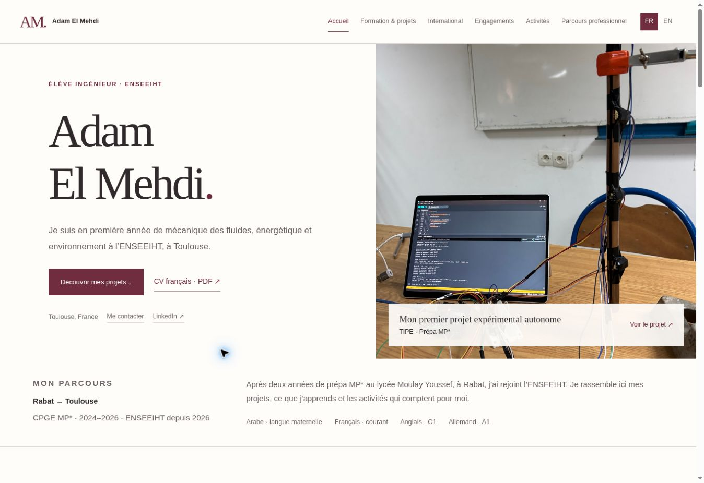
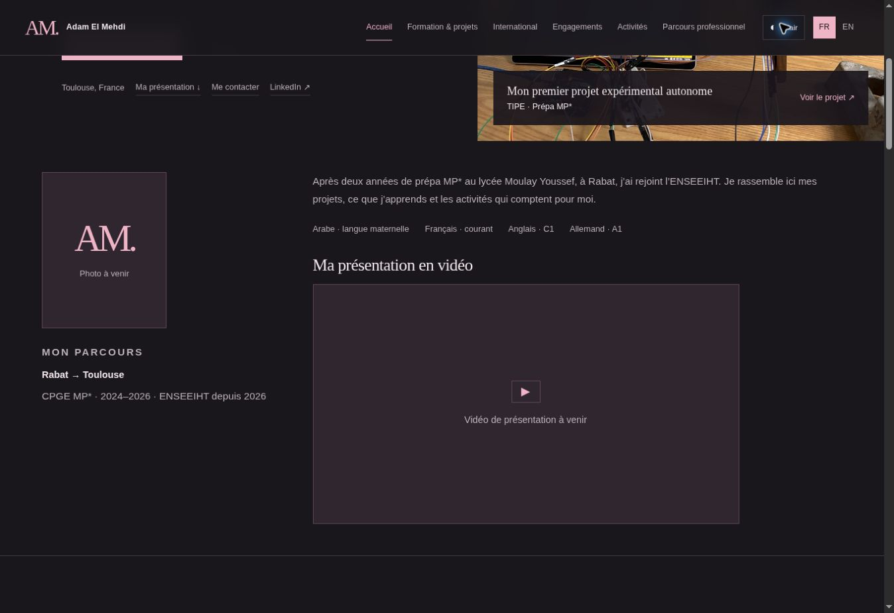

# Adam El Mehdi — Engineering portfolio

Portfolio personnel bilingue français / anglais, publié sur https://adam-el-mehdi.github.io/.



## Version Story

Adaptation personnelle du thème **Story**, par AJ / HTML5 UP : https://html5up.net/story.
La licence CC BY 3.0 est conservée dans `LICENSE-STORY.txt` et l’attribution figure en pied de page.
La feuille CSS de base provient du miroir `zce/html5up/story/assets/css/main.css`. Les imports de polices et d’icônes inutilisés ont été retirés. La personnalisation est dans `assets/css/portfolio-story.css` et les interactions dans `assets/js/story-portfolio.js`.

Site statique, sans installation, compilation, formulaire serveur ni suivi statistique.

## Contenu et navigation

Les six rubriques convenues sont conservées : WELCOME ; Engineering Courses ; International Mobility ; Sustainability and Civic Engagement ; Sport and Other Activities ; Career Development.
Le menu utilise des libellés courts dans la langue sélectionnée. Les intitulés complets restent visibles dans les sections.

- `index.html` : parcours, projets, compétences, mobilité, engagements, activités, CV et contact.
- `projects/tipe.html` : montage réel, démarche expérimentale, résultats et présentation PDF.
- `projects/imsa.html` : démonstration fictive, exemple de contrôle et contribution au hackathon.
- `docs/` : CV français / anglais et présentation du TIPE sans identifiant de concours.

Les textes sont stockés dans les attributs `data-fr` / `data-en`. Le choix de langue est conservé localement et peut être transmis avec `?lang=en`. Le CV correspondant à la langue est mis en avant à l’accueil. Sans JavaScript, le français reste accessible.

## Visuels et données

Les photographies du TIPE sont extraites sans modification des photos incorporées dans la présentation fournie par Adam. Le graphique est le rendu de la page 29 du PDF public. Les coefficients et incertitudes proviennent des pages 29 à 31.

La capture IMSA montre la véritable interface sur un document entièrement fictif. L’exemple R12 (100 euros contre 105 euros, écart de 5 euros) provient de l’analyse locale de ce dossier fictif. Le gabarit est fixé pour cette démonstration ; ce n’est pas une mesure de performance. Aucun dossier médical réel ni capture brute contenant des identifiants n’est publié.

Les participations, objectifs de mobilité et responsabilités sont présentés selon les informations validées. Aucun stage, échange confirmé, responsabilité associative supérieure ou résultat industriel n’est inventé.

## Publication

GitHub Pages publie la branche `main` depuis la racine. Les liens internes sont relatifs ; les PDF s’ouvrent dans un nouvel onglet. Le site respecte les préférences de réduction des animations et propose un lien d’évitement, une navigation au clavier et un agrandissement des images.

## Thème et médias personnels

Le bouton de thème est disponible sur les trois pages. La première visite suit le thème système ; un choix manuel clair/sombre est conservé dans le navigateur.

La photo et le pitch vidéo se placent dans l’introduction de l’accueil. Pour les activer, modifier `assets/js/profile-media.js` :

```javascript
window.AdamPortfolioMedia = {
  photo: 'assets/images/portrait.jpg',
  video: 'assets/media/pitch.mp4',
  poster: '',
  captions: ''
};
```

Ajouter les fichiers correspondants au dépôt. Le champ vidéo accepte un fichier MP4 directement lisible (local ou URL HTTPS directe), pas une page YouTube. `poster` peut désigner une image d’aperçu, `captions` un fichier WebVTT de sous-titres français. Sans fichier, des emplacements « à venir » restent affichés. Aucun téléversement public ni bouton de lecture factice n’est ajouté au portfolio.


